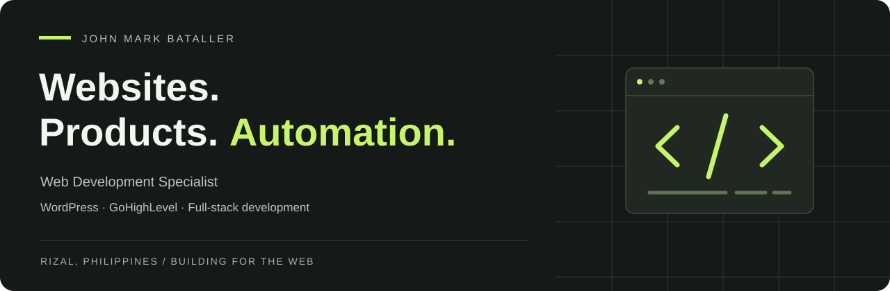

  

  <a href="https://jmqbataller.vercel.app/">View portfolio ↗</a> &nbsp;·&nbsp;
  <a href="https://resumetidy.com/">Explore ResumeTidy ↗</a> &nbsp;·&nbsp;
  <a href="mailto:jmarkbataller.work@gmail.com">Let's work together ↗</a>

## Websites that work. Products with purpose.

I'm John Mark Bataller, a Web Development Specialist based in Rizal, Philippines. I build and maintain responsive websites, landing pages, funnels, and full-stack applications—with 3+ years of hands-on web development experience.

My work connects design with the details behind it: usable interfaces, reliable forms, integrations, technical SEO, and careful testing across devices.

### What I bring to a project

| Focus | How I help |
| :--- | :--- |
| WordPress & Elementor | Custom layouts, reusable sections, maintenance, troubleshooting, and performance improvements |
| GoHighLevel | Websites, funnels, booking flows, lead-capture forms, popups, and integrations |
| Full-stack development | Web applications, authentication, database-backed features, and API integrations |
| Automation & AI | n8n workflows, webhooks, LLM API integrations, and AI-assisted development |
| Quality & SEO | Responsive QA, metadata, heading structure, broken-link fixes, and technical optimization |

## Featured project · ResumeTidy

### Helping jobseekers take the next step.

[ResumeTidy](https://resumetidy.com/) is an AI-powered resume and job application platform I designed and developed, with a focus on helping Filipino jobseekers.

- Resume/CV creation, ATS analysis, and resume improvement
- Job description matching and cover letter generation
- Authentication, subscription plans, and usage credits
- Responsive interfaces built with Next.js, Supabase, and PostgreSQL
- AI features powered by OpenRouter APIs

[Visit ResumeTidy ↗](https://resumetidy.com/)

## My toolkit

| Websites & interfaces | Applications & data | Delivery & integrations |
| :--- | :--- | :--- |
| WordPress · Elementor · GoHighLevel | Next.js · PHP · Laravel | Git · GitHub · Vercel |
| HTML · CSS · JavaScript · Bootstrap | Supabase · PostgreSQL · MySQL | REST APIs · Webhooks · n8n |
| Responsive design · UI/UX | Authentication · AI integrations | Technical SEO · Cross-device QA |

## A little more about me

- Currently working as a Website Specialist / Virtual Assistant at The Kumpanya LLC.
- Previously worked on full-stack Laravel applications at MISOut and WordPress websites at NoypiGuru.
- BS Information Systems graduate, University of Rizal System–Binangonan (2025).
- Dean's Lister for eight semesters and full-stack developer for an award-winning public-market management capstone.
- I use tools such as ChatGPT Codex and Claude Code alongside hands-on development, debugging, and testing.

---

### Have a website or product in mind?

I'm open to remote web development, WordPress, GoHighLevel, and automation projects.

[Portfolio](https://jmqbataller.vercel.app/) &nbsp; / &nbsp; [jmarkbataller.work@gmail.com](mailto:jmarkbataller.work@gmail.com)
